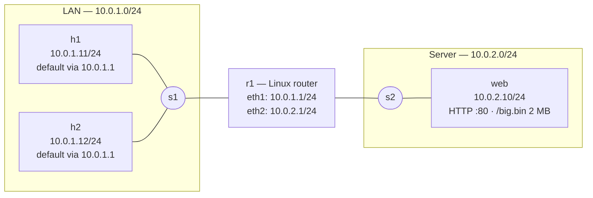

# Mininet Network Diagnosis Lab

A hands-on lab for practicing **network troubleshooting** on a small emulated network. `lab.py` builds a two-subnet topology inside Mininet, injects exactly one realistic fault (wrong route, silent firewall drop, MTU blackhole, duplicate IP, and so on), and drops you into the Mininet CLI. The cause is hidden: your job is to find it with the same tools you would use on real Linux hosts — `ip`, `ping`, `traceroute`, `tcpdump`, `ss`, `iptables`, `tc`, and friends.

Everything runs on a single Linux kernel. Each "host", "switch", and "router" is just a network namespace or an OVS bridge, so no VMs, images, or external controller are involved.

## About the project

**What you practice**

- Working bottom-up through the layers: link → address → ARP/L2 → gateway → L3 → path → transport → application.
- Reading real symptoms (`Destination Host Unreachable`, timeouts, `Connection refused`, transfers that stall after the handshake) and turning them into a hypothesis.
- Confirming a hypothesis with packet captures on both sides of a router instead of guessing.
- Fixing the fault live, then verifying the fix from multiple nodes.

**How the lab is built**

- `build()` creates hosts `h1`, `h2`, `web`, two OVS switches (`s1`, `s2`), and `r1`, a `LinuxRouter` (a Mininet host subclass with `net.ipv4.ip_forward` enabled).
- `start_services()` serves a small index page and a 2 MB `/big.bin` from `web` with Python's HTTP server, so you can test both small and large transfers.
- Each entry in `SCENARIOS` injects **one** fault using ordinary Linux tooling (`ip route`, `iptables`, `tc`, `sysctl`, link status), which is also how you would break — and fix — a real box.
- There is no automatic grader. Compare your conclusion with the revealed cause and, if you like, add your own fault functions.

## How a session works

1. `sudo python3 lab.py --scenario <name>` builds and starts the topology, then applies the fault.
2. You get the `mininet>` prompt. Prefix commands with a node name, e.g. `h1 ping -c3 10.0.2.10`.
3. Diagnose the problem. `--hint` prints a one-line symptom if you get stuck.
4. Exit the CLI to see the cause (except in `mystery` mode, which writes it to `/tmp/mininet_lab_answer.txt` and hides it until you run `--reveal`).

## Repository layout

| Path | Purpose |
|---|---|
| `lab.py` | Builds the topology, starts services, defines and injects all scenarios |
| `README.md` | Setup, topology, diagnosis method, and symptom reference |
| `/tmp/mininet_lab_answer.txt` | Cause of the last `mystery` scenario, written when it starts |

## Scenarios

Exactly one fault is active per run. `healthy` is the baseline for comparison.

| Scenario | Injected fault |
|---|---|
| `healthy` | None — learn what normal looks like |
| `wrong_gateway` | `h1` default route points at nonexistent `10.0.1.99` |
| `no_forwarding` | IP forwarding disabled on `r1` |
| `firewall_drop` | `web` silently DROPs TCP/80 |
| `firewall_reject` | `web` REJECTs TCP/80 with a reset |
| `service_down` | The HTTP server process on `web` is killed |
| `high_latency_loss` | netem on `web-eth0`: 200 ms ± 50 ms delay, 15% loss |
| `bandwidth_limit` | token bucket on `web-eth0`: 500 kbit/s |
| `mtu_blackhole` | `r1-eth1` MTU 1200 plus dropped ICMP "frag needed" (PMTUD blackhole) |
| `duplicate_ip` | `h2` is reassigned `h1`'s address, `10.0.1.11` |
| `link_down` | Link between `r1` and `s2` is down |

`--scenario mystery` picks one of the fault scenarios at random, so you cannot prepare for it in advance.

## Setup (Ubuntu/Debian, VM or WSL2 with a real kernel; not plain Docker)

    sudo apt update
    sudo apt install -y mininet openvswitch-switch tcpdump iperf3 curl traceroute mtr-tiny dnsutils iproute2 iptables
    sudo systemctl enable --now openvswitch-switch
    sudo mn --test pingall        # sanity check
    sudo mn -c                    # clean up after a crashed run

## Topology

## Run

    sudo python3 lab.py --list
    sudo python3 lab.py --scenario healthy          # learn the baseline first
    sudo python3 lab.py --scenario wrong_gateway --hint
    sudo python3 lab.py --scenario mystery          # random, cause hidden
    sudo python3 lab.py --reveal                    # check your answer afterwards

In the `mininet>` prompt prefix a command with the node name: `h1 ping -c3 10.0.2.10`.
`xterm h1 r1` opens real terminals (needs X). `h1 tcpdump ...` works too; use `&` to background.

## Diagnosis method: bottom-up

| Layer | Question | Commands (run on the node) |
|---|---|---|
| Link | Is the interface up? | `ip -br link`, `ip -s link show dev h1-eth0` (errors/drops) |
| Address | Right IP/mask? Duplicates? | `ip -br addr`, `arping -D -I h1-eth0 10.0.1.11` |
| L2 | Does ARP resolve? | `ip neigh`, `arping -c3 10.0.1.1`, `tcpdump -n -i h1-eth0 arp` |
| Gateway | Right default route? | `ip route`, `ip route get 10.0.2.10` |
| L3 | Reach local, gateway, remote? | `ping -c3 10.0.1.1` then `ping -c3 10.0.2.10` (work outwards) |
| Path | Where does it stop? | `traceroute -n 10.0.2.10`, `mtr -n -r -c10 10.0.2.10` |
| Router | Is it forwarding? | `r1 sysctl net.ipv4.ip_forward`, `r1 ip route`, `r1 iptables -S` |
| MTU | Do big packets die? | `ping -M do -s 1472 -c3 10.0.2.10`, `tracepath -n 10.0.2.10` |
| L4 | Port open/filtered? | `ss -tlnp` (on server), `curl -v -m5 http://10.0.2.10/`, `nc -zv -w3 10.0.2.10 80` |
| Firewall | Rules/counters? | `iptables -S`, `iptables -L -n -v` (watch packet counters) |
| Perf | Latency/loss/throughput? | `ping -c20`, `iperf3 -s` on web + `iperf3 -c 10.0.2.10`, `tc qdisc show` |
| Capture | What is on the wire? | `tcpdump -n -i r1-eth1 host 10.0.2.10`, `tcpdump -n -i any icmp` |

## Reading the symptoms

- **Destination Host Unreachable from the gateway**: L2/L3 problem on the far side of that router.
- **Destination Host Unreachable from yourself**: ARP failing (nothing answered).
- **Timeout** (no reply, no error): silent drop, so suspect DROP firewall, no route back, or forwarding off.
- **Connection refused** (instant): host reachable, nothing listening or REJECT rule.
- **Handshake OK, big transfer stalls**: MTU/PMTUD blackhole; test with `ping -M do -s`.
- **Slow but working**: `ping` stats for loss/jitter, `tc qdisc show`, `iperf3`.
- **Works sometimes**: duplicate IP or flapping; check `ip neigh` for changing MACs.

## Useful tricks

- Compare captures on both sides of the router (`r1-eth1` and `r1-eth2`) to see where packets vanish.
- `tcpdump -n -i r1-eth2 -w /tmp/r2.pcap`, then open it in Wireshark on the host.
- `iptables -L -n -v` counters tell you which rule is actually eating packets.
- Change things live: `h1 ip route replace default via 10.0.1.1`, `r1 sysctl -w net.ipv4.ip_forward=1`, `web iptables -F`, `web tc qdisc del dev web-eth0 root`.
- Add your own faults: edit `lab.py`, write a function and register it in `SCENARIOS`.

## Ideas to extend

1. Add a second router and a static-route misconfiguration (asymmetric routing).
2. Add DNS with `dnsmasq` on a node and break resolution (`dig @10.0.2.53 web.lab`).
3. Add VLANs/OVS flows, or a NAT router with `iptables -t nat -A POSTROUTING -j MASQUERADE`.
4. Script a checker that runs your diagnosis commands and compares to the answer.
